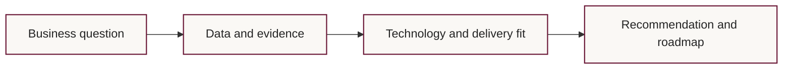
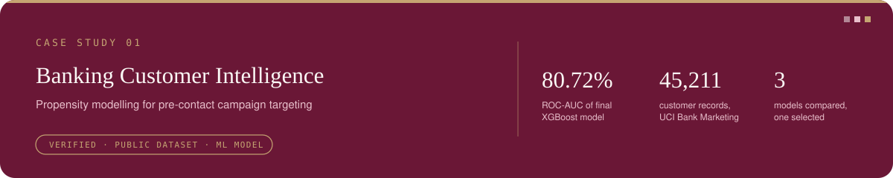
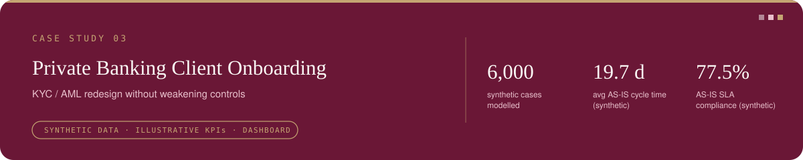
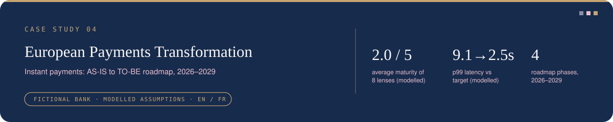

  

  <a href="#about">About</a> &nbsp;·&nbsp;
  <a href="#selected-case-studies">Case studies</a> &nbsp;·&nbsp;
  <a href="#consulting-toolkit">Toolkit</a> &nbsp;·&nbsp;
  <a href="#github-activity">Activity</a> &nbsp;·&nbsp;
  <a href="#connect">Connect</a>

  <em>I connect business problems to data and technology, then to recommendations someone can act on. 
  The business question comes first. Analytics, machine learning and delivery discipline follow from it.</em>

## About

I work across **banking and insurance**, from B2B property and casualty offers to sanctions screening operations, pricing intelligence and management control. I have combined business analysis, PMO, change management and UAT coordination with data analytics and machine learning. I am positioned as a **business and data transformation consultant**, not as a pure data scientist: my value is in connecting the business problem, financial services context, data, technology and delivery into one coherent recommendation.

<table>
<tr>
<td width="33%" valign="top"><strong>Business Analysis &amp; PMO</strong> From ambiguous needs to clear requirements, plans and governance.</td>
<td width="33%" valign="top"><strong>Banking &amp; Insurance</strong> Financial services context first, technology second.</td>
<td width="33%" valign="top"><strong>Financial Services Transformation</strong> Operating models, roadmaps and business cases.</td>
</tr>
<tr>
<td valign="top"><strong>Data Analytics &amp; Machine Learning</strong> From KPI frameworks to propensity models.</td>
<td valign="top"><strong>Change Management &amp; UAT</strong> Adoption, testing and sign-off treated as part of delivery.</td>
<td valign="top"><strong>BI &amp; Process Optimisation</strong> Make the bottleneck visible, then remove it.</td>
</tr>
</table>

## Selected case studies

Four personal portfolio projects, each built to show the same chain: **business challenge → analysis → technology → results → interpretation → application**. They use public or synthetic data, and every banner states which. Nothing here is client work.

 

<table>
<tr><th align="left" width="21%" valign="top">Business challenge</th><td>How can a bank identify which customers are more likely to subscribe to a term deposit <em>before</em> contacting them?</td></tr>
<tr><th align="left" valign="top">Analytical approach</th><td>UCI Bank Marketing dataset (45,211 records). Data preparation and exploration, feature encoding, comparison of Logistic Regression, Random Forest and XGBoost, then selection of XGBoost. I excluded <code>duration</code> because it is only known during or after the call; keeping it would have leaked information and made the model unrealistic for pre-contact targeting.</td></tr>
<tr><th align="left" valign="top">Technology &amp; methodology</th><td>Python, Pandas, NumPy, scikit-learn, XGBoost, Joblib, Matplotlib, Seaborn, Jupyter. Streamlit application for customer-level scoring.</td></tr>
<tr><th align="left" valign="top">Verified results</th><td>ROC-AUC <strong>80.72%</strong> · Accuracy 89.69% · Precision 66.49% · Recall 24.01% · F1 35.28%</td></tr>
<tr><th align="left" valign="top">Business interpretation</th><td>ROC-AUC is the headline metric because the goal is to <strong>rank</strong> customers, not classify them at a fixed threshold. The output is a ranking signal, not a causal estimate, and belongs alongside business rules, segmentation, operational constraints and human judgement. With recall at 24.01%, it is a prioritisation aid rather than a complete filter.</td></tr>
<tr><th align="left" valign="top">Practical applications</th><td>Campaign prioritisation and customer targeting. A pattern for business-facing propensity tools that show a score, a propensity level and the model's limits.</td></tr>
<tr><th align="left" valign="top">Explore</th><td><a href="https://github.com/AishwaryaMarkandu/banking-customer-intelligence">Repository</a><!-- TODO: add the live Streamlit app link here once it is published --></td></tr>
</table>

 

<table>
<tr><th align="left" width="21%" valign="top">Business challenge</th><td>Where is customer pain concentrated in financial services, and which operational areas deserve transformation attention first?</td></tr>
<tr><th align="left" valign="top">Analytical approach</th><td>CFPB Consumer Complaint Database, January 2021 to December 2025, processed in chunks with the raw source left untouched. Data quality assessment, product and issue analysis, operational KPIs, trend analysis, then a transparent priority score and priority matrix.</td></tr>
<tr><th align="left" valign="top">Technology &amp; methodology</th><td>Python with chunked processing, KPI analysis and data visualisation. Priority score weights: 35% complaint volume, 35% untimely response rate, 20% average response delay, 10% issue concentration. Interactive dashboard on GitHub Pages.</td></tr>
<tr><th align="left" valign="top">Verified results</th><td><strong>10.77M</strong> complaints analysed, <strong>99.54%</strong> timely response rate. Top-ranked signal: Student Loan, dealing with the lender or servicer (score 0.849, 39,347 complaints). Debt Collection recurs in the top ten, including attempts to collect a debt not owed (292,112 complaints, score 0.753).</td></tr>
<tr><th align="left" valign="top">Business interpretation</th><td>These are signals worth investigating, not evidence of operational failure. The score supports prioritisation; it does not measure financial loss. The CFPB itself cautions that complaint data is not a statistically representative sample of consumers.</td></tr>
<tr><th align="left" valign="top">Practical applications</th><td>Shortlisting where to run process-owner workshops, workflow mapping and root-cause analysis next, then assessing interventions by expected value, feasibility and operational dependencies.</td></tr>
<tr><th align="left" valign="top">Explore</th><td><a href="https://github.com/AishwaryaMarkandu/banking-operations-transformation">Repository</a> &nbsp;·&nbsp; <a href="https://aishwaryamarkandu.github.io/banking-operations-transformation/">Interactive dashboard</a></td></tr>
</table>

 

<table>
<tr><th align="left" width="21%" valign="top">Business challenge</th><td>How can a Luxembourg private bank cut onboarding friction and cycle time <em>without</em> weakening risk-based KYC / AML controls?</td></tr>
<tr><th align="left" valign="top">Analytical approach</th><td>Reproducible synthetic dataset of 6,000 onboarding cases (fixed random seed). Diagnosis of cycle time, SLA performance, manual effort and rework, then opportunity scoring (35% business value, 20% feasibility, 25% risk reduction, 20% client experience), a target operating model, a business case and a five-phase roadmap: Stabilise, Simplify, Orchestrate, Scale, Optimise.</td></tr>
<tr><th align="left" valign="top">Technology &amp; methodology</th><td>Python, Pandas, NumPy, Matplotlib. Standalone HTML, CSS and JavaScript dashboard on GitHub Pages. Regulatory framing built on CSSF AML/CFT guidance and DORA.</td></tr>
<tr><th align="left" valign="top">Verified results</th><td><em>All figures are synthetic and illustrate the method, not a real bank.</em> AS-IS: 19.7 days average cycle time (18.0 median), 77.5% SLA compliance, about 4 relationship-manager hours per case, about 50% of cases with rework, about 15% high-risk. Document collection concentrates manual touchpoints, missing-document events and rework. Illustrative targets, stated as scenario assumptions: about 28% shorter cycle time, about 22% less RM effort, 35% less rework, +12 points of SLA compliance.</td></tr>
<tr><th align="left" valign="top">Business interpretation</th><td>Automate and simplify the process <em>around</em> the controls, not the control decisions themselves. Risk-based routing keeps human decision points where they matter.</td></tr>
<tr><th align="left" valign="top">Practical applications</th><td>A baseline-and-diagnosis template for onboarding programmes: structured document intake, KYC workflow orchestration, an RM cockpit and an exception and SLA dashboard. In a real engagement the assumptions would be validated with historical data, process mining and interviews.</td></tr>
<tr><th align="left" valign="top">Explore</th><td><a href="https://github.com/AishwaryaMarkandu/private-banking-client-onboarding-transformation">Repository</a> &nbsp;·&nbsp; <a href="https://aishwaryamarkandu.github.io/private-banking-client-onboarding-transformation/">Interactive dashboard</a></td></tr>
</table>

 

<table>
<tr><th align="left" width="21%" valign="top">Business challenge</th><td>A euro-area bank met the 2025 instant payments deadlines by wrapping a batch-era stack in an instant gateway. What does it take to move from <em>compliant</em> to <em>transformed</em>?</td></tr>
<tr><th align="left" valign="top">Analytical approach</th><td>Eight-lens diagnosis (payment flows, processes, fraud controls, customer experience, settlement and liquidity, exceptions, compliance, architecture), AS-IS to TO-BE design, scenario replay, and a four-phase roadmap: Foundation (2026), Process Transformation (2027), Automation (2028), Intelligent Operations (2029). Includes a business analysis toolkit: stakeholder map, eight business requirements, four personas and a risk register.</td></tr>
<tr><th align="left" valign="top">Technology &amp; methodology</th><td>Single-file interactive case study in HTML, CSS and vanilla JavaScript with inline SVG charts, published on GitHub Pages. Fully bilingual, English and French.</td></tr>
<tr><th align="left" valign="top">Verified results</th><td><em>Fictional reference bank; every bank-level figure is a stated modelling assumption. Market and regulatory facts come from public sources listed in the repository.</em> Average maturity 2.0 / 5 (compliance strongest at 3.0, architecture and exception handling weakest at 1.5). p99 latency 9.1 s for the bolt-on stack against 2.5 s for the target design, within a 10 s limit. Straight-through rate 91.0% to 99.2%. Base case: about €48M programme cost, about €22M annual benefit by 2029, payback in 2030.</td></tr>
<tr><th align="left" valign="top">Business interpretation</th><td>Compliance got banks to the starting line; the operating model decides who stays in the race. The weak points sit in the seams between fraud, sanctions, liquidity and exception handling.</td></tr>
<tr><th align="left" valign="top">Practical applications</th><td>A reusable structure for payment-modernisation diagnostics: maturity lenses, a latency budget, scenario replay, a phased roadmap with exit gates and a business case sandbox. The next step would be replacing assumptions with real exception logs, production traces and weekend flows.</td></tr>
<tr><th align="left" valign="top">Explore</th><td><a href="https://github.com/AishwaryaMarkandu/european-payments-transformation">Repository</a> &nbsp;·&nbsp; <a href="https://AishwaryaMarkandu.github.io/european-payments-transformation/">Live case study (EN / FR)</a></td></tr>
</table>

 

**Also in the portfolio:** [Luxembourg Wealth Management Operating Model Benchmark](https://github.com/AishwaryaMarkandu/luxembourg-wealth-benchmark), a market study of four wealth management operating-model archetypes ending in five strategic recommendations, built on public market sources. The four banks are archetypes, not real institutions. [Open the interactive report](https://aishwaryamarkandu.github.io/luxembourg-wealth-benchmark/).

## Consulting toolkit

<table>
<tr>
<th align="left" width="24%" valign="top">▪ Business &amp; Transformation</th>
<td>Business analysis · PMO · change management · UAT coordination · process optimisation · requirements and stakeholder mapping · target operating model design · roadmaps with exit gates · business cases</td>
</tr>
<tr>
<th align="left" valign="top">▪ Financial Services</th>
<td>Banking · insurance · private banking onboarding (KYC / AML) · instant payments (SEPA, SCT Inst) · wealth management operating models · property &amp; casualty insurance (IARD), B2B commercial offer · sanctions and name screening operations (FircoSoft) · pricing intelligence and management control · regulatory awareness (CSSF, DORA, Instant Payments Regulation)</td>
</tr>
<tr>
<th align="left" valign="top">▪ Data &amp; Analytics</th>
<td>Business intelligence · KPI frameworks and scoring models · interactive dashboards · seeded synthetic data generation 

</td>
</tr>
<tr>
<th align="left" valign="top">▪ Machine Learning &amp; AI</th>
<td>Supervised classification · model comparison and evaluation · leakage-aware modelling · propensity scoring · model deployment as a business-facing app 

</td>
</tr>
<tr>
<th align="left" valign="top">▪ Project Delivery &amp; Governance</th>
<td>PMO · UAT coordination · RACI · risk registers · KPI and benefits tracking · phased delivery roadmaps with exit gates</td>
</tr>
</table>

## GitHub activity

GitHub's native contribution graph appears on this profile page, in GitHub's own green. The cards below are generated by a third-party statistics service from my public repositories, so they stay accurate as the portfolio grows and may occasionally load slowly.

  
  &nbsp;
  

## Personal signature

<table>
<tr>
<td width="30%" align="center" valign="middle">
  
</td>
<td valign="middle">
  <strong>Meet Fin.</strong> My AI companion: small, cheerful, and fond of a well-labelled chart.  
  <strong>Details I care about:</strong> legible charts, labelled assumptions and honest limitations. 
  <strong>Languages:</strong> Français · English · தமிழ் (Tamil) 
  <strong>Based in:</strong> Paris
</td>
</tr>
</table>

## Connect

<table>
<tr><th align="left" width="21%">GitHub</th><td><a href="https://github.com/AishwaryaMarkandu">github.com/AishwaryaMarkandu</a></td></tr>
<tr><th align="left">LinkedIn</th><td><a href="https://www.linkedin.com/in/aishwarya-markandu-838541265/">linkedin.com/in/aishwarya-markandu-838541265</a></td></tr>
<tr><th align="left" valign="top">Live projects</th><td>
<a href="https://aishwaryamarkandu.github.io/banking-operations-transformation/">Banking Operations &amp; Transformation (dashboard)</a> 
<a href="https://aishwaryamarkandu.github.io/private-banking-client-onboarding-transformation/">Private Banking Client Onboarding (dashboard)</a> 
<a href="https://AishwaryaMarkandu.github.io/european-payments-transformation/">European Payments Transformation (case study)</a> 
<a href="https://aishwaryamarkandu.github.io/luxembourg-wealth-benchmark/">Luxembourg Wealth Benchmark (report)</a>
</td></tr>
</table>

 

Case studies are personal portfolio projects built on public or synthetic data. Figures marked synthetic or modelled are illustrative assumptions, not client results. Not affiliated with any bank or consultancy.

